1. Выборка всех данных из таблицы

1.1. Что хотим получить: Все данные о студентах.
```
SELECT * FROM student;
```
Результат выполнения запроса: 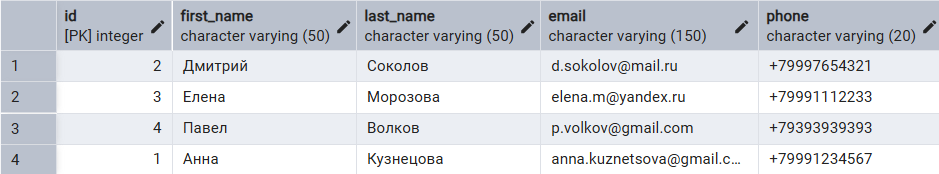

1.2. Что хотим получить: Все данные о курсах.
```
SELECT * FROM course;
```
Результат выполнения запроса: 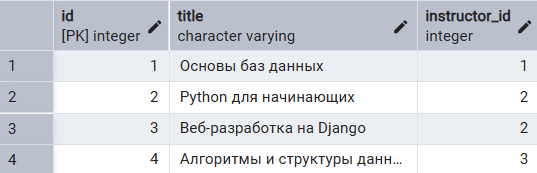

2. Выборка отдельных столбцов.

2.1. Что хотим получить: Имена и фамилии студентов.
```
SELECT first_name, last_name FROM student;
```

Результат выполнения запроса: 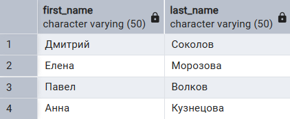

2.2. Что хотим получить: Названия курсов и ID их преподавателей.
```
SELECT title, instructor_id FROM course;
```

Результат выполнения запроса: 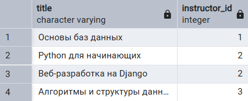

3. Присвоение новых имен столбцам при формировании выборки.

3.1. Что хотим получить: Имя и фамилия студента с русскоязычными заголовками столбцов.
```
SELECT first_name AS "Имя", last_name AS "Фамилия" FROM student;
```

Результат выполнения запроса: 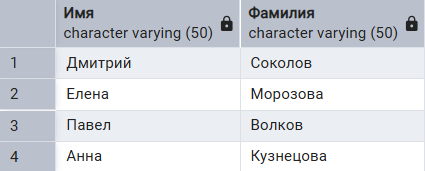

3.2. Что хотим получить: Название курса под псевдонимом.
```
SELECT title AS "Название дисциплины", id AS "Код курса" FROM course;
```

Результат выполнения запроса: 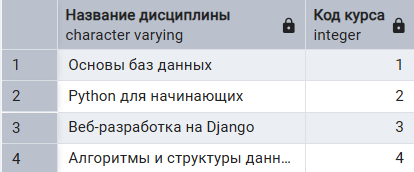

4. Выборка данных с созданием вычисляемого столбца.

4.1. Полное имя студента.
```
SELECT first_name, last_name, CONCAT(first_name, ' ', last_name) AS full_name FROM student;
```

Результат выполнения запроса: 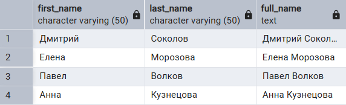

4.2. Что хотим получить: Длину названия каждого курса.
```
SELECT title, LENGTH(title) AS title_length FROM course;
```

Результат выполнения запроса: 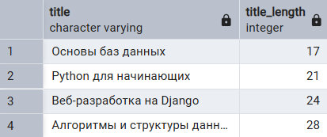

5. Выборка с CASE.

5.1. Что хотим получить: Определить четность ID студента.
```
SELECT id, first_name, CASE WHEN id % 2 = 0 THEN 'Четный' ELSE 'Нечетный' END AS id_parity FROM student;
```

Результат выполнения запроса: 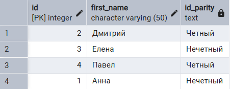

5.2. Что хотим получить: Категоризация курсов в зависимости от преподавателя.
```
SELECT title, CASE WHEN instructor_id = 1 THEN 'Основной преподаватель' ELSE 'Дополнительный' END AS role_type FROM course;
```

Результат выполнения запроса: 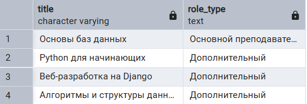

6. Выборка данных по условию.

6.1. Что хотим получить: Студентов с ID больше 2.
```
SELECT * FROM student WHERE id > 2;
```

Результат выполнения запроса: 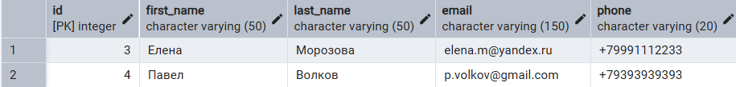

6.2. Что хотим получить: Курсы, которые ведет преподаватель с ID 2.
```
SELECT * FROM course WHERE instructor_id = 2;
```

Результат выполнения запроса: 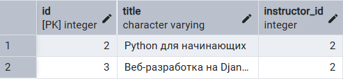

7. Выборка данных с вычисляемыми столбцами.

7.1. Что хотим получить: Оценки студентов, переведенные в проценты
```
SELECT student_id, course_id, grade, grade * 20 AS grade_percentage FROM enrollment;
```

Результат выполнения запроса: 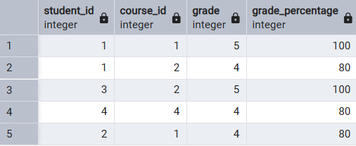

7.2. Что хотим получить: Дату напоминания об assignment (за 7 дней до сдачи).
```
SELECT description, due_date, due_date - INTERVAL '7 days' AS reminder_date FROM assignment;
```

Результат выполнения запроса: 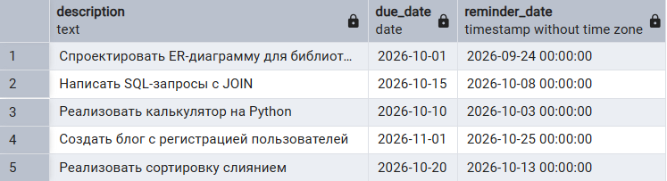

8. Выборка данных с логическими операциями

8.1. Что хотим получить: Студента с конкретным именем И фамилией.
```
SELECT * FROM student WHERE first_name = 'Дмитрий' AND last_name = 'Соколов';
```

Результат выполнения запроса: 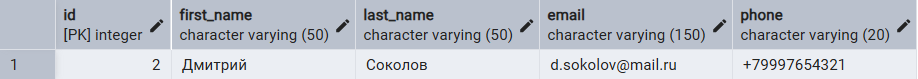

8.2. Что хотим получить: Курсы с ID 1 ИЛИ преподавателем 3 (OR).
```
SELECT * FROM course WHERE id = 1 OR instructor_id = 3;
```
Результат выполнения запроса: 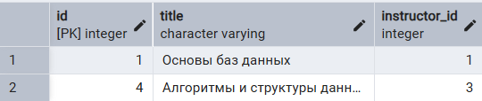

9. Выборка данных с BETWEEN, IN.

9.1. Что хотим получить: Записи о зачислении с оценками от 4 до 5 (BETWEEN).
```
SELECT * FROM enrollment WHERE grade BETWEEN 4 AND 5;
```
Результат выполнения запроса: 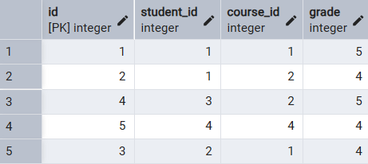

9.2. Что хотим получить: Студентов с ID 1 или 3 (IN).
```
SELECT * FROM student WHERE id IN (1, 3);
```

Результат выполнения запроса: 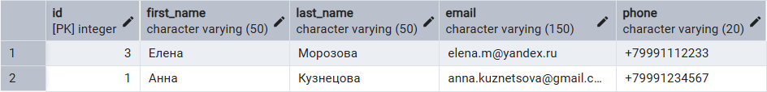

10. Выборка данных с сортировкой (SELECT ... ORDER BY)

10.1. Что хотим получить: Студенты, отсортированные по имени (от А до Я).
```
SELECT * FROM student ORDER BY first_name ASC;
```

Результат выполнения запроса: 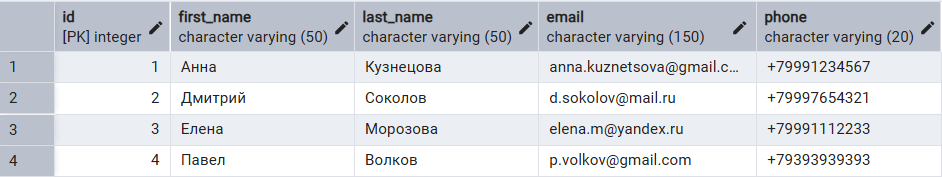


10.2. Что хотим получить: Курсы, отсортированные по названию (от Я до А).
```
SELECT * FROM course ORDER BY title DESC;
```

Результат выполнения запроса: 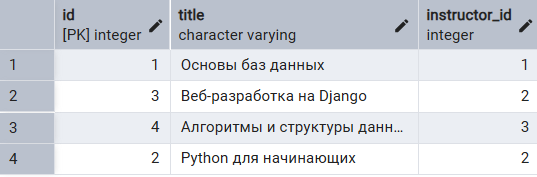

11. Выборка данных, оператор LIKE (с символами-шаблонами)

11.1. Что хотим получить: Студентов с почтой в домене gmail.com.
```
SELECT * FROM student WHERE email LIKE '%@gmail.com';
```

Результат выполнения запроса: 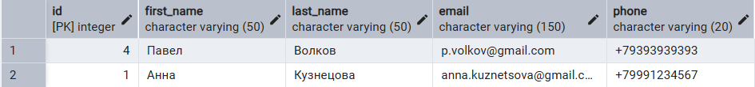

11.2. Что хотим получить: Курсы, название которых начинается на 'Python'.
```
SELECT * FROM course WHERE title LIKE 'Python%';
```

Результат выполнения запроса: 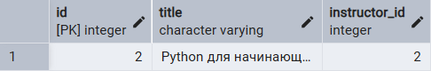

12. Выбор уникальных элементов столбца (SELECT DISTINCT)

12.1. Что хотим получить: Уникальные ID курсов, на которые кто-либо записан.
```
SELECT DISTINCT course_id FROM enrollment;
```

Результат выполнения запроса: 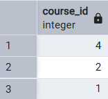

12.2. Что хотим получить: Уникальные ID преподавателей, ведущих курсы.
```
SELECT DISTINCT instructor_id FROM course;
```

Результат выполнения запроса: 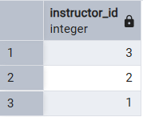

13. Выбор ограниченного количества возвращаемых строк (LIMIT, OFFSET)

13.1. Что хотим получить: Первые 2 студента из таблицы.
```
SELECT * FROM student LIMIT 2;
```
Результат выполнения запроса: 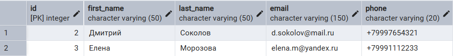

13.2. Что хотим получить: 2 задания, пропустив первые 2 (пагинация).
```
SELECT * FROM assignment LIMIT 2 OFFSET 2;
```

Результат выполнения запроса: 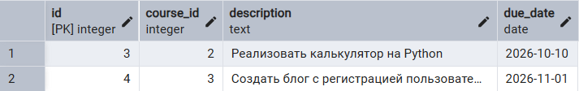

14. Соединение INNER JOIN

14.1. Что хотим получить: Имена студентов и названия курсов, на которые они записаны.
```
SELECT s.first_name, s.last_name, c.title 
FROM student s 
INNER JOIN enrollment e ON s.id = e.student_id 
INNER JOIN course c ON e.course_id = c.id;
``` 

Результат выполнения запроса: 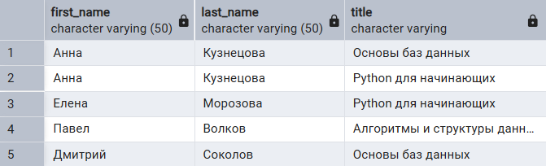

14.2. Что хотим получить: Названия курсов и имена преподавателей, которые их ведут.
```
SELECT c.title, i.name 
FROM course c 
INNER JOIN instructor i ON c.instructor_id = i.id;
```

Результат выполнения запроса: 

15. Соединение LEFT JOIN

15.1. Что хотим получить: Всех студентов и их оценки (если студент не записан ни на один курс, оценка будет NULL).
```
SELECT s.first_name, s.last_name, e.grade 
FROM student s 
LEFT JOIN enrollment e ON s.id = e.student_id;
```
Результат выполнения запроса: 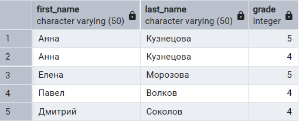

15.2. Что хотим получить: Все курсы и задания к ним (если у курса нет заданий, поле description будет NULL).
```
SELECT c.title, a.description 
FROM course c 
LEFT JOIN assignment a ON c.id = a.course_id;
```

Результат выполнения запроса: 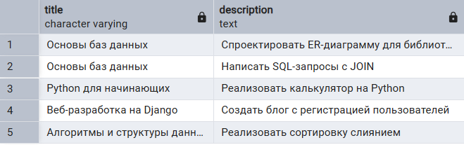

16. Соединение RIGHT JOIN

16.1. Что хотим получить: Всех студентов и их оценки, используя RIGHT JOIN (начиная от таблицы enrollment).
```
SELECT s.first_name, s.last_name, e.grade 
FROM enrollment e 
RIGHT JOIN student s ON e.student_id = s.id;
```

Результат выполнения запроса: 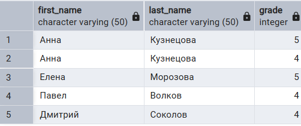

16.2. Что хотим получить: Всех преподавателей и курсы, которые они ведут.
```
SELECT c.title, i.name 
FROM course c 
RIGHT JOIN instructor i ON c.instructor_id = i.id;
```

Результат выполнения запроса: 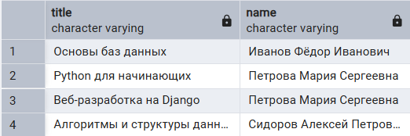

17. Соединение CROSS JOIN

17.1. Что хотим получить: Декартово произведение всех студентов и всех курсов.
```
SELECT s.first_name, c.title 
FROM student s 
CROSS JOIN course c;
```
Результат выполнения запроса: 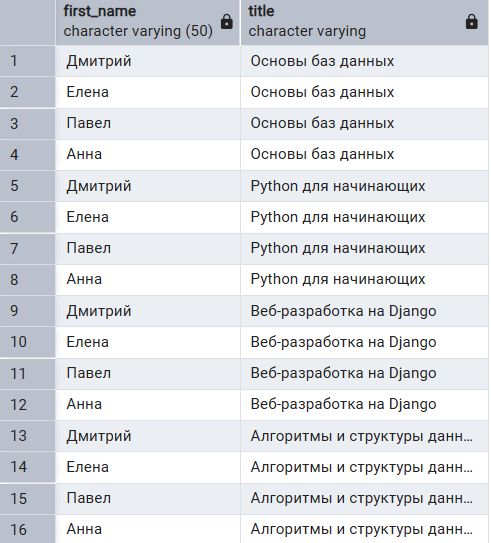

17.2. Что хотим получить: Декартово произведение всех преподавателей и всех курсов.
```
SELECT i.name, c.title 
FROM instructor i 
CROSS JOIN course c;
```

Результат выполнения запроса: 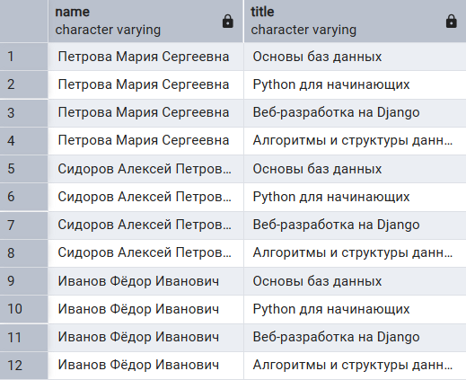

18. Соединение OUTER JOIN (FULL OUTER JOIN)

18.1. Что хотим получить: Всех студентов и все записи о зачислении, включая тех, кто не записан, и тех, кто записан, но удален из студентов.
```
SELECT s.first_name, s.last_name, e.grade 
FROM student s 
FULL OUTER JOIN enrollment e ON s.id = e.student_id;
```

Результат выполнения запроса: 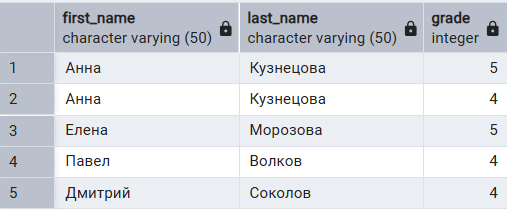

18.2. Что хотим получить: Все курсы и всех преподавателей, включая курсы без преподавателей и преподавателей без курсов.
```
SELECT c.title, i.name 
FROM course c 
FULL OUTER JOIN instructor i ON c.instructor_id = i.id;
```

Результат выполнения запроса: 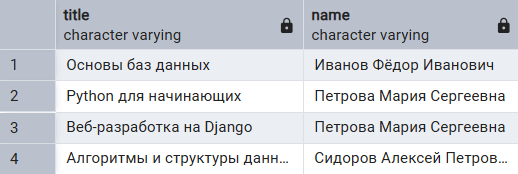