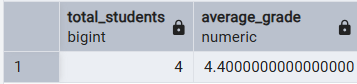
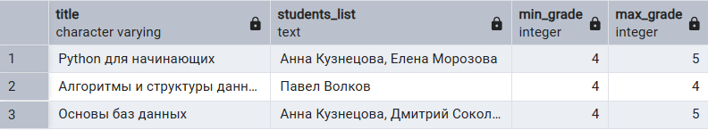
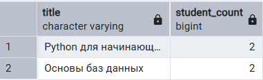
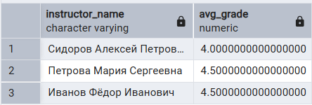
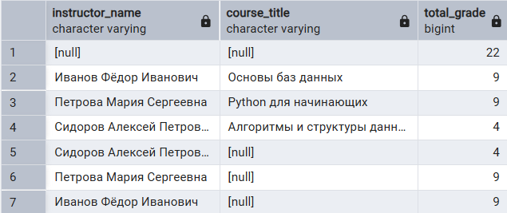
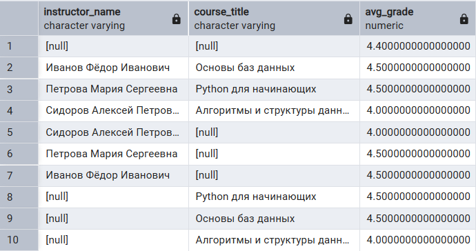
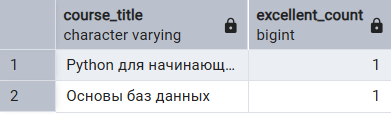
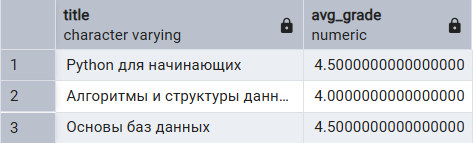

## 1. Агрегатные функции (COUNT, SUM, AVG, MIN, MAX, STRING_AGG)

1.1 Количество студентов и средняя оценка
```
SELECT 
COUNT(DISTINCT s.id) AS total_students,
AVG(e.grade) AS average_grade
FROM student s 
LEFT JOIN enrollment e ON s.id = e.student_id;
```

Результат выполнения запроса: 

1.2 Список студентов по курсам, минимальная и максимальная оценки
```
SELECT 
c.title, STRING_AGG(s.first_name || ' ' || s.last_name, ', ') AS students_list, MIN(e.grade) AS min_grade, MAX(e.grade) AS max_grade
FROM course c 
JOIN enrollment e ON c.id = e.course_id
JOIN student s ON e.student_id = s.id
GROUP BY c.title;
```

Результат выполнения запроса: 

## 2. GROUP BY, HAVING

2.1. Курсы с количеством студентов больше 1
```
SELECT 
c.title, COUNT(e.student_id) AS student_count
FROM course c 
JOIN enrollment e ON c.id = e.course_id
GROUP BY c.title
HAVING COUNT(e.student_id) > 1;
```

Результат выполнения запроса: 

2.2. Преподаватели со средним баллом студентов выше 3
```
SELECT 
i.name AS instructor_name,
AVG(e.grade) AS avg_grade
FROM instructor i 
JOIN course c ON i.id = c.instructor_id
JOIN enrollment e ON c.id = e.course_id
GROUP BY i.name
HAVING AVG(e.grade) > 3;
```

Результат выполнения запроса: 

## 3. GROUPING SETS, ROLLUP и CUBE

3.1. ROLLUP: Итоговые суммы оценок по преподавателям и курсам
```
SELECT 
i.name AS instructor_name,
c.title AS course_title,
SUM(e.grade) AS total_grade
FROM instructor i 
JOIN course c ON i.id = c.instructor_id
JOIN enrollment e ON c.id = e.course_id
GROUP BY ROLLUP(i.name, c.title);
```

Результат выполнения запроса: 

3.2. CUBE: Средний балл в разрезе всех возможных комбинаций преподавателей и курсов
```
SELECT 
i.name AS instructor_name,
c.title AS course_title,
AVG(e.grade) AS avg_grade
FROM instructor i
JOIN course c ON i.id = c.instructor_id
JOIN enrollment e ON c.id = e.course_id
GROUP BY CUBE(i.name, c.title);
```

Результат выполнения запроса: 

## 4. Комбинированный запрос (SELECT, FROM, WHERE, GROUP BY, HAVING, ORDER BY)

4.1. Количество отличников на курсах
```
SELECT 
c.title AS course_title,
COUNT(e.student_id) AS excellent_count
FROM course c
JOIN enrollment e ON c.id = e.course_id
WHERE e.grade = 5
GROUP BY c.title
HAVING COUNT(e.student_id) > 0
ORDER BY excellent_count DESC;
```

Результат выполнения запроса: 

4.2. Средний балл студентов, родившихся после 2000 года
```
SELECT 
c.title,
AVG(e.grade) AS avg_grade
FROM course c
JOIN enrollment e ON c.id = e.course_id
JOIN student s ON e.student_id = s.id
WHERE s.birth_date > '2000-01-01'
GROUP BY c.title
HAVING AVG(e.grade) > 3.5
ORDER BY c.title ASC;
```

Результат выполнения запроса: 