1. Подзапрос в SELECT

1.1. Вывести имя студента и количество курсов, на которые он записан.
```
SELECT first_name, last_name,
	(SELECT COUNT(*) FROM Enrollment e WHERE e.student_id = s.id) AS course_count
FROM Student s;
```

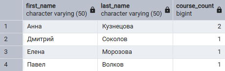

1.2. Вывести название курса и средний балл по этому курсу.
```
SELECT title,
	(SELECT AVG(grade) FROM enrollment e WHERE c.id = e.course_id) AS avg_grade
FROM course c;
```

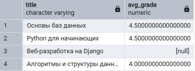

2. Подзапрос в FROM

2.1. Вывести средний балл по каждому курсу, соединив результаты подзапроса с таблицей курсов.
```
SELECT c.title, stats.avg_grade
FROM (
    SELECT course_id, AVG(grade) AS avg_grade 
    FROM Enrollment 
    GROUP BY course_id
) AS stats
JOIN Course c ON c.id = stats.course_id;
```

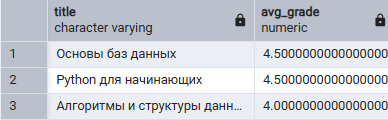

2.2. Найти преподавателей, у которых больше 1 курса
```
SELECT i.name, course_counts.count AS courses_count
FROM (SELECT instructor_id, COUNT(*) AS count
	FROM course
	GROUP BY instructor_id) AS course_counts
JOIN instructor i ON i.id = course_counts.instructor_id
WHERE course_counts.count > 1;
```

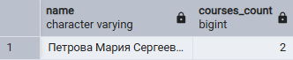

3. Подзапрос в WHERE

3.1. Вывести имена студентов, у которых есть хотя бы одна оценка 5.
```
SELECT first_name, last_name
FROM student
WHERE id IN (SELECT student_id FROM enrollment WHERE grade = 5)
```

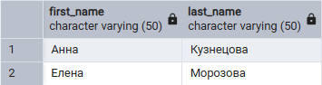

3.2. Вывести названия курсов, на которые записан студент с id = 1.
```
SELECT title 
FROM course
WHERE id IN (
SELECT course_id FROM enrollment WHERE student_id = 1
)
```

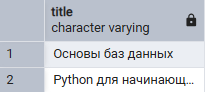

4. Подзапрос в HAVING

4.1. Вывести курсы, средняя оценка за которые выше общего среднего балла по всей базе.
```
SELECT course_id, AVG(grade) AS course_avg
FROM enrollment
GROUP BY course_id
HAVING AVG(grade) > (SELECT AVG(grade) FROM enrollment)
```

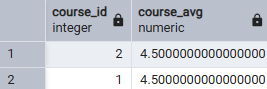

4.2. Вывести преподавателей, у которых количество курсов больше среднего количества курсов на одного преподавателя.
```
SELECT instructor_id, COUNT(*)
FROM course
GROUP BY instructor_id
HAVING COUNT(*) > (SELECT AVG(count) FROM 
	(SELECT COUNT(*) AS count FROM course GROUP BY instructor_id) AS sub)
```

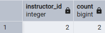

5. ALL

5.1. Вывести имена студентов, у которых все оценки равны 5.
```
SELECT first_name, last_name
FROM student s
WHERE 5 = ALL (
	SELECT grade FROM enrollment e WHERE e.student_id = s.id AND grade IS NOT NULL
);
```


5.2. Вывести курсы, у которых максимальная оценка больше всех оценок студента с id=4
```
SELECT title
FROM course
WHERE id IN (
	SELECT course_id FROM enrollment 
	WHERE grade > ALL (SELECT grade FROM enrollment WHERE student_id = 4 AND grade IS NOT NULL)
);
```

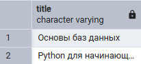

6. IN

6.1. Вывести названия курсов, на которые есть хотя бы одна запись.
```
SELECT title 
FROM course
WHERE id IN (SELECT course_id FROM enrollment);
```

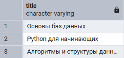

6.2. Вывести имена преподавателей, которые ведут курсы.
```
SELECT name 
FROM instructor 
WHERE id IN (SELECT instructor_id FROM course);
```

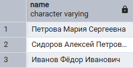

7. ANY / SOME

7.1. Вывести названия курсов, на которых есть оценки выше 4.
```
SELECT title 
FROM course 
WHERE id = ANY (SELECT course_id FROM enrollment WHERE grade > 4)
```

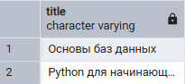

7.2. Вывести студентов, чьи оценки выше, чем какая-либо оценка студента с id=2.
```
SELECT first_name, last_name
FROM student 
WHERE id IN (
	SELECT student_id FROM enrollment
	WHERE grade > ANY (SELECT grade FROM enrollment WHERE student_id = 2 AND grade IS NOT NULL)
);
```

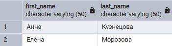

8. EXIST / NOT EXISTS

8.1. Вывести студентов, у которых есть хотя бы одна запись на курс.
```
SELECT first_name, last_name
FROM student s
WHERE EXISTS (SELECT 1 FROM enrollment e WHERE e.student_id = s.id);
```

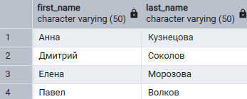

8.2. Вывести курсы, на которые не записан ни один студент.
```
SELECT title 
FROM course c
WHERE NOT EXISTS (SELECT 1 FROM enrollment e WHERE e.course_id = c.id);
```


9. Сравнение по нескольким столбцам.

9.1. Вывести записи (student_id, course_id), где пара (student_id, course_id) совпадает с такими же парами из таблицы Enrollment.
```
SELECT student_id, course_id, grade
FROM enrollment
WHERE (student_id, course_id) IN (
	SELECT student_id, course_id FROM enrollment WHERE grade = 5
);
```

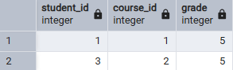

9.2. Найти студента и курс, у которых оценка 5, используя кортежное сравнение.
```
SELECT s.first_name, c.title
FROM Student s
JOIN Enrollment e ON s.id = e.student_id
JOIN Course c ON e.course_id = c.id
WHERE (e.student_id, e.grade) IN (
    SELECT id, 5 FROM Student
);
```

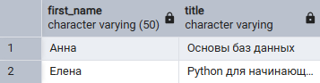

10. Коррелированные подзапросы

10.1. Вывести имя студента и его максимальную оценку.
```
SELECT s.first_name, 
	(SELECT MAX(grade) FROM enrollment e WHERE e.student_id = s.id) AS max_grade
FROM student s;
```

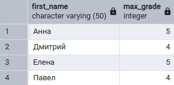

10.2. Вывести название курса и количество записавшихся студентов.
```
SELECT c.title,
	(SELECT COUNT(*) FROM enrollment e WHERE e.course_id = c.id) AS students_count
FROM course c;
```

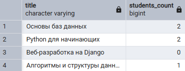

10.3. Вывести имена студентов, у которых средний балл выше 4.
```
SELECT first_name 
FROM student s
WHERE (SELECT AVG(grade) FROM enrollment e WHERE s.id = e.student_id) > 4;
```

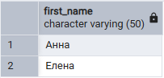

10.4. Вывести названия курсов, у которых есть задания.
```
SELECT c.title
FROM course c 
WHERE EXISTS (SELECT 1 FROM assignment a WHERE a.course_id = c.id);
```

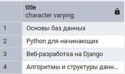

10.5. Вывести имена преподавателей, у которых нет ни одного курса.
```
SELECT i.name
FROM instructor i
WHERE NOT EXISTS (SELECT 1 FROM course c WHERE c.instructor_id = i.id);
```

