1. CTE (Общие табличные выражения)
1.1. Вывести названия курсов и их средний балл, при условии, что средний балл строго больше 4.0.

```
WITH avg_grades AS (
SELECT course_id, AVG(grade) AS avg_grade
FROM enrollment 
GROUP BY course_id)
SELECT c.title, ag.avg_grade
FROM course c JOIN 
avg_grades ag ON c.id = ag.course_id
WHERE ag.avg_grade > 4
```

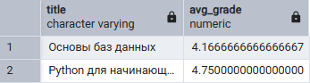

1.2. Вывести общее количество студентов и количество студентов, имеющих оценку 5, используя два отдельных CTE.

```
WITH students AS (
SELECT COUNT(*) as c FROM student
),
students_5 AS (
SELECT COUNT(*) AS c
FROM enrollment
WHERE grade = 5
)
SELECT students.c AS total_students, students_5.c AS excellent_students
FROM students, students_5
```

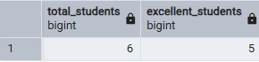

1.3. Найти преподавателя, у которого самое большое количество записей студентов на его курсы. Вывести имя и количество студентов.
```
WITH load AS (
SELECT i.name, COUNT(e.student_id) AS c
FROM instructor i JOIN 
course c ON c.instructor_id = i.id JOIN
enrollment e ON c.id = e.course_id
GROUP BY name
)
SELECT name, c FROM load
ORDER BY c DESC LIMIT 1
```
2. UNION, INTERSECT, EXCEPT
2.1. (UNION) Вывести единый список имен всех студентов и преподавателей с указанием их роли.
```
SELECT first_name AS name, 'Студент' AS role
FROM student
UNION 
SELECT name, 'Преподаватель' AS role
FROM instructor
```
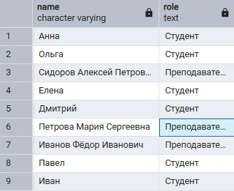

2.2. (INTERSECT) Вывести ID курсов, на которые одновременно записаны студенты и для которых созданы задания.
```
SELECT course_id FROM Enrollment
INTERSECT
SELECT course_id FROM Assignment;
```
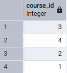

2.3. (EXCEPT) Вывести ID и имена студентов, которые не записаны ни на один курс.
```
SELECT id, first_name FROM Student
EXCEPT
SELECT student_id, first_name FROM Student s JOIN Enrollment e ON s.id = e.student_id;
```
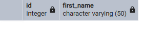

3. Оконные функции
3.1. PARTITION BY (2 запроса)

3.1.1. Вывести ID студента, ID курса, оценку и средний балл по данному конкретному курсу в каждой строке.
```
SELECT student_id, course_id, grade, AVG(grade) OVER(PARTITION BY course_id) FROM Enrollment;
```
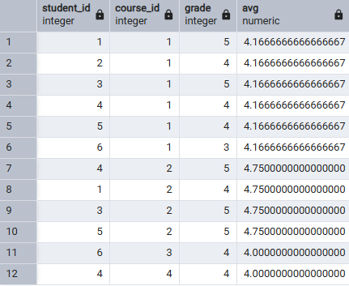

3.1.2. Вывести ID курса, ID студента, оценку и максимальную оценку в рамках данного курса в каждой строке.
```
SELECT course_id, student_id, grade, MAX(grade) OVER(PARTITION BY course_id) FROM Enrollment;
```
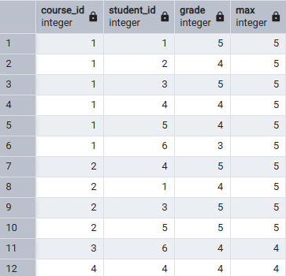

3.2. PARTITION BY + ORDER BY (2 запроса)

3.2.1. Вывести ID курса, ID студента, оценку и накопительную сумму оценок внутри каждого курса (сортировка по student_id).
```
SELECT course_id, student_id, grade, SUM(grade) OVER(PARTITION BY course_id ORDER BY student_id) FROM Enrollment;
```
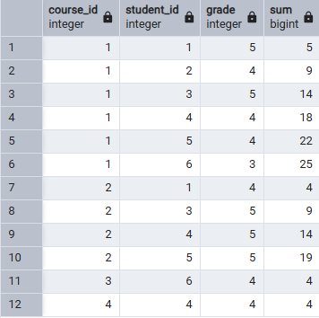

3.2.2. Вывести ID курса, ID студента, оценку и скользящее среднее оценок внутри курса (сортировка по grade).
```
SELECT course_id, student_id, grade, AVG(grade) OVER(PARTITION BY course_id ORDER BY grade) FROM Enrollment;
```
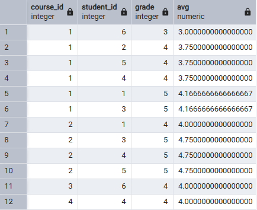

3.3. ROWS и RANGE (по 2 запроса)

3.3.1 (ROWS) Вывести ID курса, ID студента, оценку и сумму текущей оценки и оценки предыдущего студента (по student_id).
```
SELECT course_id, student_id, grade, 
       SUM(grade) OVER(PARTITION BY course_id ORDER BY student_id ROWS BETWEEN 1 PRECEDING AND CURRENT ROW) 
FROM Enrollment;
```
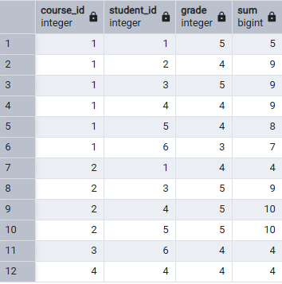

3.3.2. (RANGE) Вывести ID курса, ID студента, оценку и сумму всех оценок от минимальной до текущей (сортировка по grade).
```
SELECT course_id, student_id, grade, 
       SUM(grade) OVER(PARTITION BY course_id ORDER BY grade RANGE BETWEEN UNBOUNDED PRECEDING AND CURRENT ROW) 
FROM Enrollment;
```
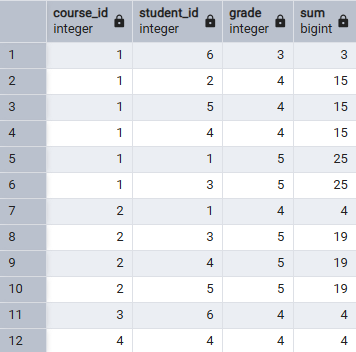

3.4. Ранжирующие функции (по 1 на каждую)

3.4.1. ROW_NUMBER: Пронумеровать студентов внутри курса №1 от лучшей оценки к худшей.
```
SELECT student_id, grade, ROW_NUMBER() OVER(ORDER BY grade DESC) FROM Enrollment WHERE course_id = 1;
```
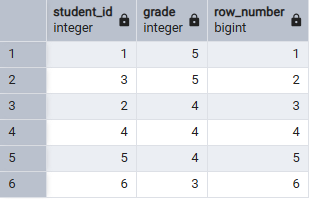

3.4.2. RANK: Проранжировать студентов курса №1 от лучшей оценки к худшей (с пропуском чисел при совпадении).
```
SELECT student_id, grade, RANK() OVER(ORDER BY grade DESC) FROM Enrollment WHERE course_id = 1;
```
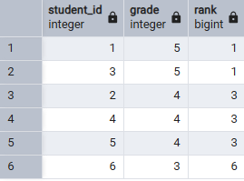

3.4.3. DENSE_RANK: Проранжировать студентов курса №1 от лучшей оценки к худшей (без пропуска чисел при совпадении).
```
SELECT student_id, grade, DENSE_RANK() OVER(ORDER BY grade DESC) FROM Enrollment WHERE course_id = 1;
```
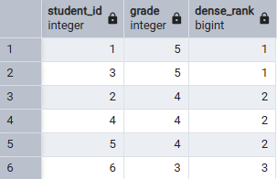

3.5. Функции смещения (по 1 на каждую)

3.5.1. LAG: Вывести для курса №1 ID студента, оценку и оценку предыдущего студента (по student_id).
```
SELECT student_id, grade, LAG(grade) OVER(ORDER BY student_id) FROM Enrollment WHERE course_id = 1;
```
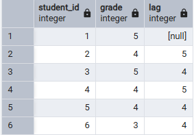

3.5.2.  LEAD: Вывести для курса №1 ID студента, оценку и оценку следующего студента (по student_id).
```
SELECT student_id, grade, LEAD(grade) OVER(ORDER BY student_id) FROM Enrollment WHERE course_id = 1;
```
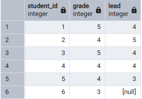

3.5.3. FIRST_VALUE: Вывести ID студента, ID курса, оценку и лучшую оценку на этом курсе в каждой строке.
```
SELECT student_id, course_id, grade, FIRST_VALUE(grade) OVER(PARTITION BY course_id ORDER BY grade DESC) FROM Enrollment;
```
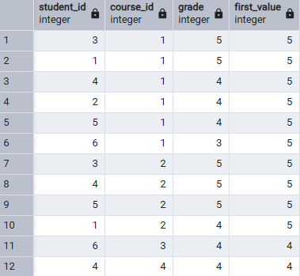

3.5.4. LAST_VALUE: Вывести ID студента, ID курса, оценку и худшую оценку на этом курсе в каждой строке.
```
SELECT student_id, course_id, grade, LAST_VALUE(grade) OVER(PARTITION BY course_id ORDER BY grade DESC ROWS BETWEEN UNBOUNDED PRECEDING AND UNBOUNDED FOLLOWING) FROM Enrollment;
```
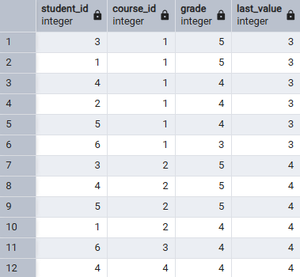