1. Базовые операции с транзакциями

1.1.1. Добавляем нового студента и записываем его на курс
```
BEGIN;
INSERT INTO student (first_name, last_name, email)
VALUES ('Петр', 'Тестовый', 'test@mail.ru');
INSERT INTO Enrollment (student_id, course_id, grade) 
VALUES ((SELECT id FROM Student WHERE email = 'test@mail.ru'), 1, 5);
COMMIT;
```
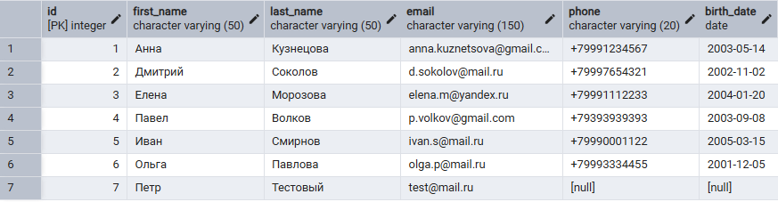
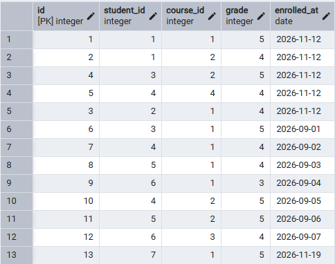

1.1.2. Добавляем новый курс и назначаем ему задание
```
BEGIN;
INSERT INTO Course (title, instructor_id) 
VALUES ('Новый курс по транзакциям', 1);

INSERT INTO Assignment (course_id, description, due_date) 
VALUES ((SELECT id FROM Course WHERE title = 'Новый курс по транзакциям'), 'Сдать ДЗ', '2026-12-31');
COMMIT;
```

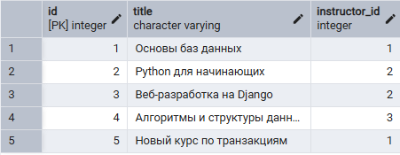
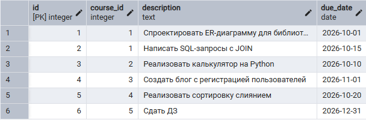

1.2.1. Пытаемся добавить студента и записать его на курс, но отменяем изменения
```
BEGIN;
INSERT INTO student (first_name, last_name, email)
VALUES ('Петр2', 'Тестовый2', 'test2@mail.ru');
INSERT INTO Enrollment (student_id, course_id, grade) 
VALUES ((SELECT id FROM Student WHERE email = 'test2@mail.ru'), 1, 5);
ROLLBACK;
```

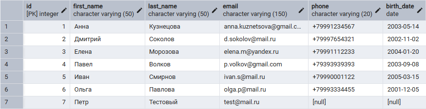
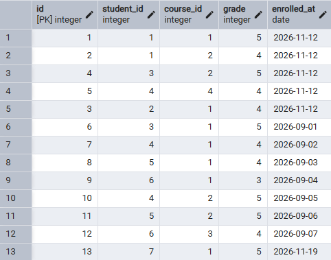

1.2.2. Пытаемся добавить новый курс и назначить ему задание, но отменяем
```
BEGIN;
INSERT INTO Course (title, instructor_id) 
VALUES ('Новый курс по транзакциям 2', 1);

INSERT INTO Assignment (course_id, description, due_date) 
VALUES ((SELECT id FROM Course WHERE title = 'Новый курс по транзакциям 2'), 'Сдать ДЗ', '2026-12-31');
ROLLBACK;
```

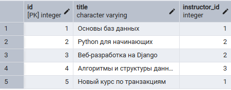
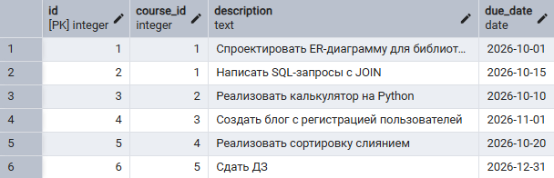

1.3.1. Вставляем студента и делаем ошибку
```
BEGIN;
INSERT INTO Student (first_name, last_name, email) 
VALUES ('Ошибочный', 'Студент', 'error1@mail.ru');

SELECT 1 / 0; 

INSERT INTO Enrollment (student_id, course_id, grade) VALUES (99, 1, 5);
COMMIT;
```

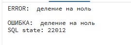

1.3.2. Обновляем курс и делаем ошибку
```
BEGIN;
UPDATE Course SET title = 'Сломанный курс' WHERE id = 2;
SELECT 1 / 0; 
COMMIT;
```

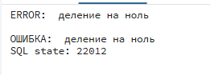

2. Уровни изоляции

2.1. READ UNCOMMITTED / READ COMMITTED (Грязное чтение)

2.1.1. 
```T1
BEGIN; 
UPDATE Enrollment SET grade = 2 WHERE id = 1;
```

```T2
SET TRANSACTION ISOLATION LEVEL READ UNCOMMITTED; 
SELECT grade FROM Enrollment WHERE id = 1;
```

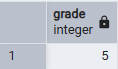

```T1
ROLLBACK
```

2.1.2.
```T1
BEGIN; 
UPDATE Course SET title = 'Секрет' WHERE id = 1;
```

```T2
SELECT title FROM Course WHERE id = 1;
```

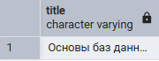

```T1
COMMIT
```

2.2. READ COMMITTED (Неповторяющееся чтение)

2.2.1. 
```T1
SET TRANSACTION ISOLATION LEVEL READ COMMITTED; 
BEGIN; 
SELECT grade FROM Enrollment WHERE id = 1;
```

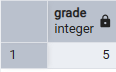

```T2
BEGIN; 
UPDATE Enrollment SET grade = 4 WHERE id = 1; 
COMMIT;
```

```T1
SELECT grade FROM Enrollment WHERE id = 1;
```

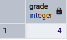

2.2.2.

```T1
BEGIN; 
SELECT title FROM Course WHERE id = 2;
```

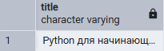

```T2
BEGIN; 
UPDATE Course SET title = 'Измененный' WHERE id = 2; 
COMMIT;
```

```T1
SELECT title FROM Course WHERE id = 2;
```

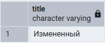

2.3. REPEATABLE READ

2.3.1. Т1 не видит изменения Т2
```T1
BEGIN; 
SET TRANSACTION ISOLATION LEVEL REPEATABLE READ; 
SELECT grade FROM Enrollment WHERE id = 1;
```

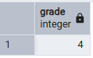

```T2
BEGIN; 
UPDATE Enrollment SET grade = 3 WHERE id = 1; 
COMMIT;
```

```T1
SELECT grade FROM Enrollment WHERE id = 1;
COMMIT
```


```T1
SELECT grade FROM Enrollment WHERE id = 1;
```

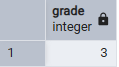

2.3.2. Фантомное чтение

```T
SET TRANSACTION ISOLATION LEVEL REPEATABLE READ; 
BEGIN; 
SELECT COUNT(*) FROM Enrollment WHERE course_id = 2;
```

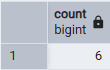

```T2
BEGIN; 
INSERT INTO Enrollment (student_id, course_id, grade) VALUES (2, 2, 5); 
COMMIT;
```

```T1
SELECT COUNT(*) FROM Enrollment WHERE course_id = 2; 
COMMIT;
```

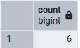

2.4. SERIALIZABLE

2.4.1. Конфликт при вставке

```T1
SET TRANSACTION ISOLATION LEVEL SERIALIZABLE; 
BEGIN;
SELECT first_name FROM Student WHERE id = 1;
```

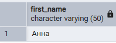

```T2
SET TRANSACTION ISOLATION LEVEL SERIALIZABLE; 
BEGIN; 
UPDATE Student SET first_name = 'Изменено Т2' WHERE id = 1;
COMMIT;
```

```T1
UPDATE Student SET first_name = 'Изменено Т1' WHERE id = 1;
COMMIT;
```

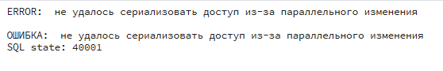

2.4.2. Повтор транзакции

BEGIN;
INSERT INTO Student (first_name, last_name, email) VALUES ('Д', 'Д', 'serial@mail.ru');
COMMIT;

3. SAVEPOINT

3.1.
```
BEGIN;
INSERT INTO Student (first_name, last_name, email) VALUES ('До', 'Сейва', 'save1@mail.ru');
SAVEPOINT my_savepoint;

INSERT INTO Student (first_name, last_name, email) VALUES ('После', 'Сейва', 'save2@mail.ru');
```

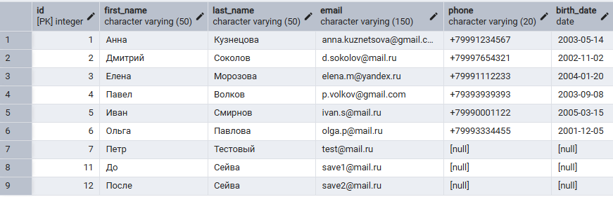

```
ROLLBACK TO my_savepoint;
COMMIT;
```

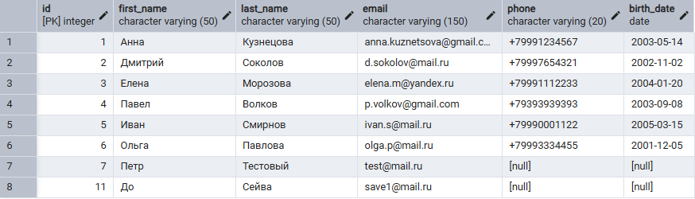
 
3.2. 
```
BEGIN;
INSERT INTO Student (first_name, last_name, email) VALUES ('Студент', 'Первый', 'sp1@mail.ru');
SAVEPOINT sp1;

INSERT INTO Student (first_name, last_name, email) VALUES ('Студент', 'Второй', 'sp2@mail.ru');
SAVEPOINT sp2;

INSERT INTO Student (first_name, last_name, email) VALUES ('Студент', 'Третий', 'sp3@mail.ru');
```

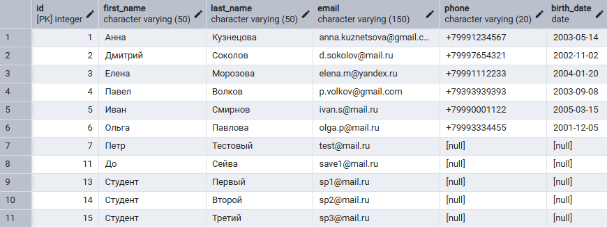

```
ROLLBACK TO sp1;
COMMIT;
```

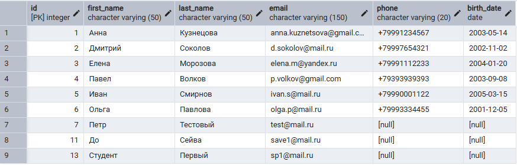

```
ROLLBACK TO sp2;
COMMIT;
```

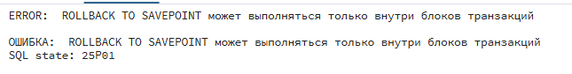